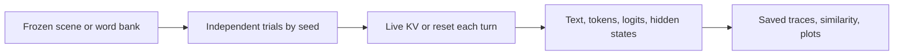

# sr_association_lab

[日本語](README.ja.md) · [Trace schema](docs/SCHEMA.md) · [Validation](docs/VALIDATION.md) · [MIT License](LICENSE)

[](https://github.com/RyoSpiralArchitect/sr_association_lab/actions/workflows/tests.yml)

Observe how a local language model moves from one association or scene to the next.

**SR Association Lab** is a single-file Python harness for word association and
sentence-by-sentence scene generation. It records the generated text, token IDs,
raw logits, selected hidden states, and timings together. Native **MLX** and
**PyTorch / Transformers** use the same trace format.

Start several trials from the same frozen scene or word bank, vary the sampling
seed, and compare a continuing KV cache with a fresh start at every turn.



The runtime is [`sr_association_lab.py`](sr_association_lab.py). There is no server,
remote judge, or API key required by the harness. Model IDs may download files
from Hugging Face; use local paths with `--local-files-only` for offline inference.

## Install

Use Python 3.11 or later and choose one inference backend.

```bash
git clone https://github.com/RyoSpiralArchitect/sr_association_lab.git
cd sr_association_lab
python3 -m venv .venv
source .venv/bin/activate
```

**MLX on Apple Silicon**:

```bash
python -m pip install -r requirements-mlx.txt
```

**PyTorch**: install the [PyTorch build for your device](https://pytorch.org/get-started/locally/), then:

```bash
python -m pip install -r requirements.txt
```

PyTorch accepts `--device cpu`, `cuda`, or `mps`. MLX accepts `cpu` or `gpu`
(Metal on Apple Silicon). Both accept `auto`. The backend is selected explicitly;
the default is `torch`.

Optional dependencies are needed only for their features: `sentence-transformers`
for an external similarity encoder, `peft` for Torch adapters, and
`accelerate` / `bitsandbytes` for the corresponding Torch placement and quantization options.
For MLX quantization, load a pre-quantized MLX checkpoint.

## Follow a scene across seeds

Point `--model` at a local checkpoint that your backend can load. For example,
with a local GPT-2 checkpoint and MLX:

```bash
python sr_association_lab.py imagine \
  --backend mlx \
  --model ./models/gpt2 \
  --device gpu \
  --scene 'At a night station, there was a light on the ridge of the platform,' \
  --language en \
  --steps 8 \
  --n-seeds 4 --seed 43 \
  --temperature 0.9 --top-p 0.95 \
  --max-new-tokens 96 \
  --local-files-only \
  --out runs/night-station
```

Each seed starts with a fresh cache and the same frozen origin. Within a `live`
trial, the exact sampled token IDs and KV state continue across turns. A fixed
continuation cue asks for one more sentence; earlier sampled text is never
re-tokenized or silently removed.

- `--scene-file` replays a saved `origin.json` or a UTF-8 scene file.
- Omitting both scene options asks the model to generate an origin once, then
  discards that generation cache before the trials begin.
- `--condition both` compares `live` with `reset`. Reset starts from the **same
  frozen origin at every step**, rather than chaining from the previous response.
- `--language ja` selects Japanese instructions. The model still determines what
  language and quality it can produce.
- `--seeds 43,44,45,46` supplies explicit seeds. `--repeats` repeats those same
  seeds; repeated seeds are not additional independent random samples.

Sentence stopping uses a punctuation heuristic. The complete sampled token is
always retained, including any text that overshoots the first sentence boundary.
Empty, malformed, and length-capped responses remain in the record and live state.

For a manual session, use `run --protocol imagination_en --interactive` with the
same model/backend/output options. Run `imagine --help` or `run --help` for the
different command interfaces.

## Compare word associations

Create a reusable bank with `bank`, or supply a text file containing one word per
line. For example, save `moon`, `door`, and `water` as separate lines in `words.txt`:

```bash
python sr_association_lab.py experiment \
  --backend torch --model ./models/local-model --device cpu \
  --bank words.txt --bank-language en \
  --seeds 43,44,45 --condition both \
  --order shuffle --order-seeds 101,102 \
  --max-new-tokens 24 --local-files-only \
  --out runs/word-associations
```

The ordered bank is frozen and checksummed. Presentation-order randomness is
separate from response randomness. One NumPy sampling RNG continues throughout
each trial. One-word eligibility is a conservative surface check, including in
Japanese; it is not a linguistic word segmenter.

## Read the results

```bash
python sr_association_lab.py plot runs/night-station
python sr_association_lab.py plot runs/night-station/trials/t0000
python sr_association_lab.py inspect runs/night-station/trials/t0000 \
  --event 0 --token 0 --top 20
```

`plot` and `inspect` read saved traces without loading model weights.

| Output | What it contains |
| --- | --- |
| `manifest.json` | Configuration, source hash, model/runtime identity, status |
| `origin.json` or `bank.json` | Frozen stimulus and checksum |
| `schedule.json` | Seeds, repeats, conditions, presentation order |
| `transcript.md`, `responses.jsonl` | Full responses and eligibility results |
| `trials/*/events/*/` | Token journals, raw logits, hidden-state arrays, metadata |
| `trials/*/session.json` | Exact consumed token ledger and session status |
| `analysis/` | Embeddings, similarities, CSV/JSON summaries |
| `plots/` | Scene paths, recurrence, timing, context growth, and label indexes |

Every completed event with **N generated tokens has N+1 valid rows**. Row 0 reads
the last prompt position. Row `t` predicts token `t`; row `t+1` records its
post-token state. The final row consumes the last token without sampling another.
Only `meta.json.valid_rows` are data; unused array capacity is not a measurement.

Sampling uses CPU NumPy float64 with temperature, exact top-k, and nucleus top-p.
Raw model logits are retained separately from processed sampling scores. Hook
capture and synchronized forward timing are recorded separately from host
transfer, sampling, and file I/O.

`--similarity self` computes isolated LM representation cosine after generation.
It is a descriptive proxy, not a dedicated semantic-similarity score. Use
`--similarity sentence-transformer --embedding-model PATH` for an external saved
encoder, or `--similarity none` to disable it.

### Evaluate saved scenes beyond cosine

```bash
python sr_association_lab.py evaluate runs/night-station
# Optional joint sentence-pair NLI classifier; requires PyTorch.
python sr_association_lab.py evaluate runs/night-station \
  --nli-model ./models/nli-deberta --nli-device cpu \
  --out runs/night-station/evaluation-nli
```

Open `evaluation/report.html` for an offline comparison by seed. Generation is
not repeated. Exact repetition, repeated trigrams, lexical overlap with source
spans, and optional **entailment / neutral / contradiction** scores remain
separate; there is no combined quality score or change to `eligible`.

For `--condition both` experiments, differences match seed/repeat/step, exclude
initial responses and average repeats within seed. Reset predecessors are
explicitly marked as **not used as context**. NLI scores are uncalibrated review
aids: new events can be neutral, and state changes can look contradictory.

Models are local-only by default. Downloads require `--allow-download`; use
`--nli-revision` to pin a Hub model. Overlong pairs become unavailable without
truncation. See [evaluation methods and limits](docs/EVALUATION.md).

## Scope and limits

- These traces describe model behavior and accessible states. They do not
  establish human-like associations, psychological mechanisms, or semantic quality.
- `eligible` means the response passed surface rules and was not length-capped.
  It is not a quality rating.
- The effective context limit is the smaller of `--max-context` and the model's
  own limit. Overflow stops before the next forward; history is never silently
  truncated. The tested GPT-2 checkpoint has a 1024-token limit, and a long
  Japanese run reached it. Reduce steps or response length when needed.
- Base models may follow the instructional prompts poorly. `run --prompt-file`
  provides an exact raw prefix with `--context reset` for continuation experiments.
- Hooks depend on model structure. `modules --model PATH --backend mlx` lists
  actual paths; `--layers`, `--hook`, and `--no-hooks` control observation.
- Full-vocabulary logits can be large. `--no-logits` keeps token statistics while
  disabling those arrays; `--no-plot` skips automatic figures.
- Sessions save token ledgers and status, not serialized KV tensors for resuming
  in another process. Generation requires a new output directory.

See the [trace schema](docs/SCHEMA.md) for alignment, cache, and timing details.

## Develop

```bash
python -m pip install pytest
OMP_NUM_THREADS=1 MKL_NUM_THREADS=1 python -m pytest -q
```

The tests create small random models and tokenizers locally. Backend-specific
tests skip when their dependencies are absent. To exercise only native MLX:

```bash
python -m pytest -q tests/test_mlx.py tests/test_compatibility.py
```

With PyTorch installed, a demo also exercises generation and plotting without
downloading model weights:

```bash
python sr_association_lab.py demo --architecture gpt2 --out runs/demo
```

Demo outputs are explicitly labeled as untrained fixtures. See
[validation](docs/VALIDATION.md) and [contributing](CONTRIBUTING.md).
Changes are tracked through Git commits and recorded source hashes, without
application release-number bookkeeping. Saved-format identifiers remain for
trace compatibility.

## License

[MIT](LICENSE). Model weights and dependencies retain their own licenses.
